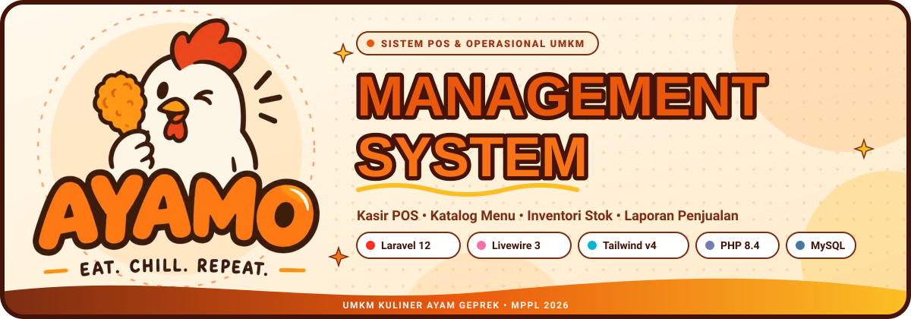
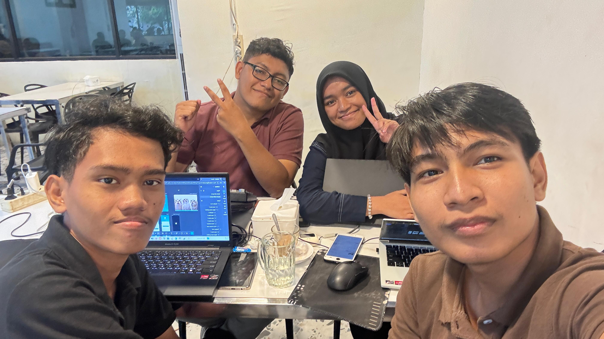
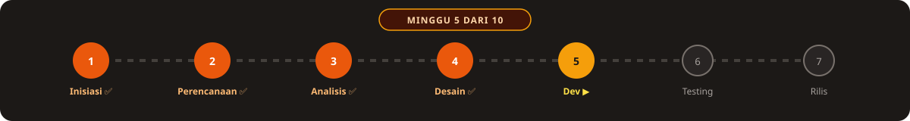

<div align="center">



<br>

[](#-tentang-proyek)
[](#%EF%B8%8F-technology-stack)
[](https://zjpwcuecoylf.jp.larksuite.com/base/Zl4qbsdyeaYoJwsvF6zjJ24Cp5b?from=from_copylink)
[](https://www.figma.com/design/1eqVfEPtoZpmDb4cUy9i60/Ayamo?node-id=6-2&t=FBl8vIPqf5UpQQzH-1)
[](#-tim-pengembang)
[](#%EF%B8%8F-peta-level-proyek)
[](#-dokumen-proyek)
[](#%EF%B8%8F-cara-main-alur-kerja-tim)

<br>


**Merencanakan dan membangun ekosistem digital terintegrasi untuk UMKM Kuliner Ayamo: Point of Sale kasir, katalog menu dinamis, inventori bahan baku, dan laporan performa penjualan.**

</div>


<a id="tentang-proyek"></a>

## 🎮 Tentang Proyek

> 🎯 **MISI:** Membangun platform digital UMKM Ayamo untuk mempercepat transaksi kasir, mengelola katalog produk secara terpusat, memantau pergerakan stok harian, dan menghasilkan laporan analitik penjualan secara real-time.
> 🕹️ **STUDI KASUS:** UMKM Kuliner Ayamo (_Eat Chill Repeat_).
> 🏁 **STAGE SAAT INI:** Minggu 8–9 dari baseline 10 minggu (18 November 2026). Seluruh fase inisiasi–perancangan (`1.1`–`3.4`), fondasi & fitur inti (`4.1`–`6.4`), integrasi & hardening (`7.1`–`7.3`), serta unit/feature test (`8.1`) telah **Selesai** (`27` aktivitas). Aktivitas yang **Sedang Dikerjakan** saat ini (`7` aktivitas): pengendalian proyek (`1.4`), regresi & cross-device testing (`8.2`), UAT pemilik UMKM (`8.3`), perbaikan UAT (`8.4`), laporan akhir (`9.1`), serta deployment/serah terima (`9.2`–`9.3`).

**Ayamo** adalah UMKM kuliner ayam goreng crispy dengan bumbu rahasia khas yang selalu digoreng hangat saat dipesan. Sistem ini mendukung pemesanan pelanggan tanpa login lewat Web maupun Mobile Web, sekaligus panel admin terpadu untuk kasir POS, pengelolaan stok, dan rekap penjualan harian.

| Kondisi Saat Ini                                          | Kebutuhan Utama                                           | Solusi Digital Ayamo                                              |
| --------------------------------------------------------- | --------------------------------------------------------- | ----------------------------------------------------------------- |
| Pemesanan masih manual & pelanggan antre di outlet        | Pemesanan online cepat tanpa wajib membuat akun           | Storefront Web & Mobile Tanpa Login + Reservasi Stok Atomik       |
| Pencatatan pesanan & verifikasi transfer belum seragam    | Alur status pesanan jelas & opsi transfer/QRIS terstruktur| Kasir POS Manual Multi-Item + Alur Pesanan 4-Tahap & 2 Tab Bayar  |
| Pembaruan harga, foto, & status toko masih manual         | Kontrol katalog, stok cepat, & buka/tutup toko fleksibel  | Panel Produk (Upload/Preview Gambar + Quick Stock) & Override Toko|
| Rekap omzet harian memakan waktu                          | Laporan transaksi instan dan export spreadsheet aman      | Dashboard Laporan UMKM + Buku Kas & Export CSV Anti Formula Injection |

<details>
<summary><b>🧺 Katalog Default Produk Ayamo — 8 Varian Menu (Klik untuk membuka)</b></summary>

<br>

| Kategori | Item Produk                                                        |
| -------- | ------------------------------------------------------------------ |
| Ayam     | Dada Ayam, Sayap Ayam, Paha Atas, Paha Bawah, Ceker Ayam, Hati Ayam, Leher Ayam |
| Camilan  | Bakso Goreng                                                       |

</details>


<a id="technology-stack"></a>

## 🛠️ Technology Stack

<div align="center">


<br><br>

| Lapisan Arsitektur       | Teknologi                                                                                     | Keterangan & Peran                                                    |
| ------------------------ | --------------------------------------------------------------------------------------------- | --------------------------------------------------------------------- |
| **Backend Framework**    | [Laravel v12](https://laravel.com/)                                                           | Kerangka kerja PHP modern untuk business logic, routing, dan security |
| **Runtime Engine**       | PHP 8.4+                                                                                      | Typed properties, performa tinggi, dan fitur sintaks modern           |
| **Frontend Reactive**    | [Livewire v3](https://livewire.laravel.com/) & [Volt](https://livewire.laravel.com/docs/volt) | Komponen UI reaktif single-file tanpa API boilerplate terpisah        |
| **UI Component Kit**     | [Livewire Flux](https://flux.livewire.com/)                                                   | Desain sistem komponen siap pakai yang selaras dengan Tailwind        |
| **Styling Engine**       | [Tailwind CSS v4](https://tailwindcss.com/) & Vite                                            | Utility-first CSS engine super cepat dan teroptimasi                  |
| **Client Interactivity** | Alpine.js                                                                                     | Micro-interactions, dropdown, modal state sisi klien                  |
| **Database**             | MySQL / MariaDB                                                                               | Penyimpanan data relasional transaksional ACID compliant              |
| **Dev & Collab Tools**   | Git, GitHub, VSCode, Lark Base, Docker                                                        | Source code, project control, dan standarisasi workspace              |

</div>


<a id="lark-base"></a>

## 📋 Manajemen Proyek dengan Lark Base

Lark Base menjadi **single source of truth** untuk jadwal, sprint, PIC, effort, biaya, risiko, dan progres proyek. Dengan satu pusat data, tim tidak perlu memperbarui status yang sama pada beberapa aplikasi.

<div align="center">

[](https://zjpwcuecoylf.jp.larksuite.com/base/Zl4qbsdyeaYoJwsvF6zjJ24Cp5b?from=from_copylink)

</div>

| Tabel atau View Lark Base | Fungsi                                                                             |
| ------------------------- | ---------------------------------------------------------------------------------- |
| **Master Schedule**       | Aktivitas WBS, sprint, tanggal, dependensi, PIC, dan status                        |
| **Resource and Effort**   | Peran anggota, alokasi manday, dan beban kerja                                     |
| **Project Cost**          | Biaya tenaga kerja, layanan, operasional, dan cadangan                             |
| **Risk Register**         | Probabilitas, dampak, mitigasi, pemilik, dan indikator risiko                      |
| **Sprint Board**          | Tampilan Kanban berdasarkan Backlog, To Do, In Progress, Review, Blocked, dan Done |

Baseline proyek berlangsung selama **10 minggu, 24 September-2 Desember 2026**. Setiap sprint berdurasi satu minggu dan ditutup dengan review. Rincian aktivitas, milestone, manday, biaya, dan risiko tersedia pada [Rencana Pengelolaan Proyek](/docs/project-management-output.md), sedangkan pembagian sprint tersedia pada [Roadmap 10 Minggu](/plan/roadmap-umkm-ayamo.md).

Seluruh data operasional tersebut dikelola pada [Lark Base Proyek Ayamo](https://zjpwcuecoylf.jp.larksuite.com/base/Zl4qbsdyeaYoJwsvF6zjJ24Cp5b?from=from_copylink).


<a id="tim-pengembang"></a>

## 👥 Tim Pengembang & Manajemen Proyek

<div align="center">


<br><br>



<br><br>

</div>

| No  | Nama Lengkap                     |     NIM     | GitHub                                                           | Peran Utama & Tanggung Jawab                                                                                                              |
| :-: | -------------------------------- | :---------: | ---------------------------------------------------------------- | ----------------------------------------------------------------------------------------------------------------------------------------- |
|  1  | **Ruhmita**                      | `230504012` | [`@rumiyeoon`](https://github.com/rumiyeoon)                     | **Project Manager & Business Analyst**<br>Inisiasi proyek, analisis kebutuhan UMKM, pemetaan menu katalog, dan pemetaan arsitektur sistem |
|  2  | **Fazah Fatahillah**             | `230504014` | [`@rizput1009`](https://github.com/rizput1009)                   | **Frontend & UI/UX Specialist**<br>Perancangan antarmuka, design system, komponen frontend, responsivitas, dan implementasi UI/UX         |
|  3  | **Muhammad Rifki Aulia Pratama** | `230504089` | [`@mrifkiauliap`](https://github.com/mrifkiauliap)               | **Backend Lead & DevOps**<br> Perancangan sistem, perancangan database, dan pengelolaan hosting dan keamanan                              |
|  4  | **Rafi Alamsyah**                | `230504024` | [`@rafialamsyah720-eng`](https://github.com/rafialamsyah720-eng) | **Frontend Developer & QA Tester**<br>Implementasi frontend bersama Fazah, skenario uji, pengujian integrasi/regresi, dan validasi rilis  |

Dokumentasi teknis tidak dibebankan kepada satu peran khusus. Setiap anggota bertanggung jawab memperbarui dokumentasi untuk requirement, desain, kode, pengujian, atau proses manajemen yang dikerjakannya.


<a id="peta-level-proyek"></a>

## 🗺️ Peta Level Proyek (Tahapan MPPL)

<div align="center">

</div>

Klik pada masing-masing level untuk meninjau rincian pekerjaan sesuai status WBS di [Lark Base](https://zjpwcuecoylf.jp.larksuite.com/base/Zl4qbsdyeaYoJwsvF6zjJ24Cp5b?from=from_copylink):

<details>
<summary><b>⭐ LEVEL 1 — Inisiasi & Pengendalian Proyek</b> &nbsp; ▶ 1.1–1.3 Selesai · 1.4 Sedang Dikerjakan</summary>

<br>

- **1.1** ✅ `Selesai` (*Ruhmita*) — Kickoff, pembagian peran, dan aturan kerja.
- **1.2** ✅ `Selesai` (*Ruhmita*) — Survei, wawancara, dan dokumentasi UMKM.
- **1.3** ✅ `Selesai` (*Ruhmita*) — Project Charter, Stakeholder Register, dan WBS.
- **1.4** ▶ `Sedang Dikerjakan` (*Ruhmita*, Minggu 1–10) — Pengendalian jadwal, scope, risiko, dan evaluasi sprint.

📄 Terkait: [Project Charter Ayamo](/docs/Project_Charter_Ayamo%20%282%29.docx)

</details>

<details>
<summary><b>⭐ LEVEL 2 — Perencanaan & Setup Repositori</b> &nbsp; ✅ Selesai</summary>

<br>

- **2.3** ✅ `Selesai` (*Muhammad Rifki Aulia Pratama*) — Workspace, repository, dan inisialisasi Laravel 12 + Livewire Volt + Tailwind CSS v4.
- **2.4** ✅ `Selesai` (*Ruhmita*) — Review dan persetujuan baseline ruang lingkup.

📄 Terkait: [Rencana Pengelolaan Proyek](/docs/project-management-output.md) · [Roadmap 10 Minggu](/plan/roadmap-umkm-ayamo.md)

</details>

<details>
<summary><b>⭐ LEVEL 3 — Analisis Kebutuhan Sistem</b> &nbsp; ✅ Selesai</summary>

<br>

- **2.1** ✅ `Selesai` (*Ruhmita*) — Analisis kebutuhan fungsional dan nonfungsional.
- **2.2** ✅ `Selesai` (*Ruhmita*) — Pemodelan alur bisnis, use case, dan acceptance criteria.

📄 Terkait: [`docs/requirements/features-and-modules.md`](/docs/requirements/features-and-modules.md)

</details>

<details>
<summary><b>⭐ LEVEL 4 — Perancangan (Design & Architecture)</b> &nbsp; ✅ Selesai</summary>

<br>

- **3.1** ✅ `Selesai` (*Fazah Rizki Fatahillah*) — Desain UI/UX customer mobile (17 screen mockup di Figma).
- **3.2** ✅ `Selesai` (*Rafi Alamsyah*) — Desain UI/UX web dan panel admin.
- **3.3** ✅ `Selesai` (*Muhammad Rifki Aulia Pratama*) — ERD, struktur database, dan revisi skema.
- **3.4** ✅ `Selesai` (*Muhammad Rifki Aulia Pratama*) — Arsitektur, keamanan, dan standar pengembangan.

📄 Terkait: [`docs/requirements/architecture.md`](/docs/requirements/architecture.md) · [`docs/requirements/database.md`](/docs/requirements/database.md) · [`docs/requirements/standards-and-conventions.md`](/docs/requirements/standards-and-conventions.md) · [`docs/mockup/mobile/README.md`](/docs/mockup/mobile/README.md) · [🎨 Figma Mockup Mobile](https://www.figma.com/design/1eqVfEPtoZpmDb4cUy9i60/Ayamo?node-id=6-2&t=FBl8vIPqf5UpQQzH-1)

</details>

<details>
<summary><b>⭐ LEVEL 5 — Pengembangan Aplikasi (Implementation)</b> &nbsp; ✅ Selesai (`4.1`–`7.3`)</summary>

<br>

- **4.1** ✅ `Selesai` (*Muhammad Rifki Aulia Pratama*) — Migration, model, seeder ([`UmkmTestingSeeder`](/app/database/seeders/UmkmTestingSeeder.php)), dan koneksi database.
- **4.2** ✅ `Selesai` (*Muhammad Rifki Aulia Pratama*) — Autentikasi, session, dan dashboard admin awal.
- **4.3** ✅ `Selesai` (*Muhammad Rifki Aulia Pratama*) — Manajemen produk, kategori, dan stok produk.
- **4.4** ✅ `Selesai` (*Rafi Alamsyah, Fazah Rizki Fatahillah*) — Katalog, detail produk, dan customer web.
- **5.1** ✅ `Selesai` (*Rafi Alamsyah, Fazah Rizki Fatahillah*) — Customer mobile dan responsivitas.
- **5.2** ✅ `Selesai` (*Rafi Alamsyah*) — Keranjang, kalkulasi total, dan checkout.
- **5.3** ✅ `Selesai` (*Muhammad Rifki Aulia Pratama*) — Metode pembayaran tunai, transfer multi-rekening, dan QRIS manual (dengan opsi unduh gambar QRIS).
- **5.4** ✅ `Selesai` (*Muhammad Rifki Aulia Pratama*) — Konfirmasi order 4-tahap dan pembaruan stok atomik (`lockForUpdate`).
- **6.1** ✅ `Selesai` (*Muhammad Rifki Aulia Pratama*) — Pencatatan transaksi dan penjualan manual (Kasir POS).
- **6.2** ✅ `Selesai` (*Rafi Alamsyah*) — Riwayat dan detail transaksi.
- **6.3** ✅ `Selesai` (*Muhammad Rifki Aulia Pratama*) — Statistik omzet, transaksi, dan produk terlaris.
- **6.4** ✅ `Selesai` (*Muhammad Rifki Aulia Pratama*) — Inventori dasar dan peringatan stok.
- **7.1** ✅ `Selesai` (*Muhammad Rifki Aulia Pratama*) — Integrasi customer, admin, order, transaksi, laporan CSV, pengaturan override toko, serta Docker production.
- **7.2** ✅ `Selesai` (*Rafi Alamsyah, Fazah Rizki Fatahillah*) — UI/UX polishing dan aksesibilitas dasar.
- **7.3** ✅ `Selesai` (*Muhammad Rifki Aulia Pratama*) — Hardening keamanan dan optimasi performa.

</details>

<details open>
<summary><b>🔹 LEVEL 6 — Pengujian Sistem (Testing & QA)</b> &nbsp; ▶ 8.1 Selesai · 8.2–8.4 Sedang Dikerjakan</summary>

<br>

- **8.1** ✅ `Selesai` (*Rafi Alamsyah*) — Penyusunan dan pelaksanaan unit/feature test.
- **8.2** ▶ `Sedang Dikerjakan` (*Rafi Alamsyah*) — Integration, regression, dan cross-device testing.
- **8.3** ▶ `Sedang Dikerjakan` (*Ruhmita*) — UAT bersama pemilik UMKM.
- **8.4** ▶ `Sedang Dikerjakan` (*Muhammad Rifki Aulia Pratama*) — Perbaikan defect dan penyesuaian UAT.

</details>

<details open>
<summary><b>🔹 LEVEL 7 — Dokumentasi Akhir & Rilis</b> &nbsp; ▶ 9.1–9.3 Sedang Dikerjakan</summary>

<br>

- **9.1** ▶ `Sedang Dikerjakan` (*Seluruh tim*) — Laporan akhir, user guide, dan dokumentasi teknis.
- **9.2** ▶ `Sedang Dikerjakan` (*Muhammad Rifki Aulia Pratama*) — Deployment, seed demo, dan persiapan presentasi.
- **9.3** ▶ `Sedang Dikerjakan` (*Ruhmita*) — Presentasi, demonstrasi, dan serah terima.

</details>

### 📊 Ringkasan Progres Proyek

- [x] **Level 1 — Inisiasi (`1.1`–`1.3`):** Selesai (*Ruhmita*); pengendalian jadwal/scope/risiko (`1.4`) terus berjalan selama 10 minggu (`Sedang Dikerjakan`)
- [x] **Level 2 — Perencanaan & Setup (`2.3`–`2.4`):** Workspace, repository, Laravel starter, dan persetujuan baseline scope (`Selesai`)
- [x] **Level 3 — Analisis Kebutuhan (`2.1`–`2.2`):** Analisis FR/NFR, alur bisnis, use case, dan acceptance criteria (`Selesai`)
- [x] **Level 4 — Perancangan (`3.1`–`3.4`):** UI/UX mobile & web/admin, ERD final, arsitektur, dan standar pengembangan (`Selesai`)
- [x] **Level 5 — Pengembangan (`4.1`–`7.3`):** Seluruh modul inti, UI/UX polishing, & hardening keamanan/performa (`Selesai`)
- [ ] **Level 6 — Pengujian (`8.1`–`8.4`):** `8.1` unit/feature test `Selesai`; `8.2` regresi lintas perangkat, `8.3` UAT pemilik UMKM, & `8.4` perbaikan defect `Sedang Dikerjakan`
- [ ] **Level 7 — Dokumentasi & Rilis (`9.1`–`9.3`):** Laporan akhir, user guide, deployment demo, dan serah terima `Sedang Dikerjakan`


<a id="dokumen-proyek"></a>

## 🎒 Dokumen & Spesifikasi Proyek

Seluruh dokumentasi teknis, manajemen proyek, dan log eksperimen disusun secara terstruktur:

| No  | Dokumen                        | Lokasi Berkas                                                                                                     | Fokus Pembahasan                                            | Status |
| :-: | ------------------------------ | ----------------------------------------------------------------------------------------------------------------- | ----------------------------------------------------------- | :----: |
|  1  | **Rencana Pengelolaan Proyek** | [`docs/project-management-output.md`](/docs/project-management-output.md)                                         | Jadwal, WBS, resource, manday, biaya, dan risiko            |   ✅   |
|  2  | **Indeks Dokumentasi Teknis**  | [`docs/requirements/README.md`](/docs/requirements/README.md)                                                     | Indeks dokumen spesifikasi sistem & alur pembaruan          |   ✅   |
|  3  | **Arsitektur Sistem & Docker** | [`docs/requirements/architecture.md`](/docs/requirements/architecture.md)                                         | Arsitektur Laravel 12, middleware, model, & setup Docker    |   ✅   |
|  4  | **Skema Basis Data**           | [`docs/requirements/database.md`](/docs/requirements/database.md)                                                 | ERD, skema migrasi aktif, reservasi stok, & `UmkmTestingSeeder`|   ✅   |
|  5  | **Standar & Konvensi**         | [`docs/requirements/standards-and-conventions.md`](/docs/requirements/standards-and-conventions.md)               | Konvensi modal/toast, SVG tanpa emoji, Tailwind CSS v4, & kode|   ✅   |
|  6  | **Spesifikasi Modul & Fitur**  | [`docs/requirements/features-and-modules.md`](/docs/requirements/features-and-modules.md)                         | Rincian storefront, POS 4-tahap, pembayaran, stok, & laporan|   ✅   |
|  7  | **Roadmap Pengembangan**       | [`plan/roadmap-umkm-ayamo.md`](/plan/roadmap-umkm-ayamo.md)                                                       | Roadmap 10 sprint, milestone, & status pelaksanaan          |   ✅   |
|  8  | **Panduan Aset Mockup**        | [`docs/mockup/README.md`](/docs/mockup/README.md) · [`docs/mockup/mobile/README.md`](/docs/mockup/mobile/README.md)| 17 screen mockup mobile view (Figma) & aset web view        |   ✅   |
|  9  | **Log Eksperimen & Debugging** | [`pembelajaran.md`](/pembelajaran.md)                                                                             | Catatan root cause bug, arsitektur UI, & verifikasi teknis  |   🔄   |
| 10  | **Project Charter**            | [`docs/Project_Charter_Ayamo (2).docx`](/docs/Project_Charter_Ayamo%20%282%29.docx)                                 | Dokumen charter awal proyek MPPL                            |   ✅   |
| 11  | **Project Control Lark Base**  | [Buka Lark Base Ayamo](https://zjpwcuecoylf.jp.larksuite.com/base/Zl4qbsdyeaYoJwsvF6zjJ24Cp5b?from=from_copylink) | Jadwal, PIC, effort, biaya, dan risk register               |   🔄   |

<details>
<summary><b>📁 Struktur Direktori Repositori</b></summary>

```text
Kelompok-17/
├── Dockerfile                      # Multi-stage Docker build produksi (Composer + Vite + PHP 8.4 + Nginx)
├── docker-compose.yml              # Orkestrasi app, mysql:8.4 (healthcheck), & profil tunnel cloudflared
├── .dockerignore                   # Eksklusi vendor, node_modules, .env, & berkas sementara
├── .env.example                    # Template environment produksi Docker Compose
├── pembelajaran.md                 # Log eksperimen, debugging, & keputusan teknis
├── README.md                       # Dokumentasi utama repositori
├── docker/                         # Konfigurasi pendukung container
│   ├── Dockerfile                  # Salinan Dockerfile konfigurasi produksi
│   ├── entrypoint.sh               # Auto APP_KEY fallback, wait MySQL, storage:link, migrate, optimize
│   ├── nginx/default.conf          # Konfigurasi web server Nginx (port 8000)
│   └── php/php-prod.ini            # Tuning PHP-FPM & OPcache produksi
├── app/                            # Direktori aplikasi Laravel 12
│   ├── .env.example                # Template environment pengembangan lokal
│   ├── app/
│   │   ├── Http/
│   │   │   ├── Controllers/        # Modular Admin/* & Customer/* controllers
│   │   │   └── Middleware/         # AdminSession & SecurityHeaders
│   │   └── Models/                 # Product, Order, Transaction, Settings, LoginAttempt, User
│   ├── database/
│   │   ├── migrations/             # Skema tabel, stock_reserved, & settings.value TEXT
│   │   └── seeders/                # DatabaseSeeder & UmkmTestingSeeder
│   ├── public/                     # Aset publik, multi-res favicon.ico, img/logo.webp
│   ├── resources/                  # Blade views, components (<x-modal-*>), CSS & JS
│   └── routes/                     # web.php (Web, Mobile, Admin)
├── assets/                         # Aset visual dokumentasi (banner, divider, footer, levels.svg)
├── docs/                           # Dokumentasi sistem, mockup Figma, & Project Charter
│   ├── mockup/                     # Mockup UI/UX mobile/ & web/
│   ├── requirements/               # architecture.md, database.md, features-and-modules.md, standards
│   ├── survey/                     # Dokumentasi foto survei UMKM
│   └── project-management-output.md
└── plan/                           # Rencana kerja sprint backlog
    └── roadmap-umkm-ayamo.md
```

</details>


<a id="cara-main-alur-kerja-tim"></a>

## 🕹️ Cara Main (Alur Kerja Tim di Repositori Ini)

Untuk menjaga kebersihan riwayat git dan mencegah konflik kode, seluruh anggota tim mengikuti alur kerja standar berikut:

<details>
<summary><b>🔧 Prosedur Kerja Git & Pull Request (Klik untuk membaca)</b></summary>

<br>

1. **Sinkronisasi Terlebih Dahulu**:
   ```bash
   git checkout main
   git pull origin main
   ```
2. **Buat Branch Khusus untuk Tugas/Fitur Baru**:
   Gunakan format penamaan `fitur/nama-fitur` atau `docs/nama-dokumen`:
   ```bash
   git checkout -b fitur/kasir-pos-order
   ```
3. **Kerjakan & Commit dengan Pesan yang Jelas**:
   ```bash
   git add .
   git commit -m "feat(pos): tambah komponen keranjang belanja dan kalkulasi total"
   ```
4. **Kirim Perubahan ke GitHub**:
   ```bash
   git push -u origin fitur/kasir-pos-order
   ```
5. **Buka Pull Request (PR)** di GitHub menuju branch `main`. Diskusikan dan lakukan peninjauan kode (_code review_) sebelum digabungkan.

</details>

<details>
<summary><b>📜 Tabel Contekan Perintah Git yang Sering Digunakan</b></summary>

<br>

| Perintah Git               | Fungsi & Kegunaan                                             |
| -------------------------- | ------------------------------------------------------------- |
| `git clone <url>`          | Mengunduh repositori proyek ke lokal                          |
| `git status`               | Memeriksa berkas yang telah diubah atau belum terdeteksi      |
| `git add .`                | Menandai seluruh perubahan untuk disimpan ke staging          |
| `git commit -m "pesan"`    | Menyimpan riwayat perubahan dengan deskripsi ringkas          |
| `git pull origin main`     | Mengambil dan menggabungkan pembaruan terbaru dari server     |
| `git push origin <branch>` | Mengunggah branch lokal ke repositori GitHub                  |
| `git checkout -b <branch>` | Membuat branch baru dan langsung berpindah ke branch tersebut |
| `git log --oneline -n 5`   | Melihat riwayat 5 commit terakhir secara ringkas              |

</details>


<a id="panduan-instalasi"></a>

## ⚙️ Panduan Instalasi & Menjalankan Aplikasi

### A. Menjalankan Secara Lokal (Development)

#### 1. Prasyarat Sistem

- **PHP** `>= 8.2` (Sangat disarankan **PHP 8.4+**)
- **Composer** `>= 2.7`
- **Node.js** `>= 20.x` & **NPM**
- **MySQL** / **MariaDB** Server (atau SQLite untuk uji lokal)

#### 2. Persiapan Environment (`app/`)

```bash
cd app
cp .env.example .env
```

Sesuaikan kredensial basis data & panel admin pada `app/.env`:

```env
APP_NAME="Ayamo - Eat Chill Repeat"
APP_URL=http://localhost:8000

DB_CONNECTION=mysql
DB_HOST=127.0.0.1
DB_PORT=3306
DB_DATABASE=ayamo_db
DB_USERNAME=root
DB_PASSWORD=
```

#### 3. Instalasi Dependensi, Migrasi, & Seeder Pengujian

```bash
composer install
npm install
php artisan key:generate
php artisan migrate

# Opsional: isi data testing UMKM lengkap (kecuali tabel products)
php artisan db:seed --class=UmkmTestingSeeder
```

#### 4. Menjalankan Server Pengembangan

Jalankan seluruh service lokal (Server Laravel, Queue, Pail log, dan Vite):

```bash
composer run dev
```

Akses melalui browser:
- **Web Storefront**: `http://127.0.0.1:8000`
- **Mobile Web View**: `http://127.0.0.1:8000/mobile`
- **Admin Dashboard**: `http://127.0.0.1:8000/admin`

---

### B. Menjalankan dengan Docker Compose (Production-Ready)

Konfigurasi kontainer produksi berada di root repositori ([`Dockerfile`](/Dockerfile), [`docker-compose.yml`](/docker-compose.yml), [`.env.example`](/.env.example)) yang memaketkan PHP 8.4-FPM, Nginx (port `8000`), asset Vite terkompilasi, serta `mysql:8.4`.

1. Salin file `.env.example` di **root repositori** dan sesuaikan `APP_KEY`, password MySQL, dan `ADMIN_PASSWORD_HASH`:
   ```bash
   cp .env.example .env
   ```
2. Bangun image dan jalankan service di latar belakang:
   ```bash
   docker compose up -d --build
   ```
3. (Opsional) Jika menggunakan Cloudflare Tunnel dengan variabel `CLOUDFLARED_TUNNEL_TOKEN`:
   ```bash
   docker compose --profile tunnel up -d
   ```

Aplikasi otomatis menjalankan `storage:link`, migrasi (`AUTORUN_MIGRATIONS=true`), dan caching Laravel saat container menyala, serta menyediakan endpoint healthcheck `/up`.

<div align="center">


**🍗 AYAMO — EAT • CHILL • REPEAT**
Tugas Manajemen Proyek Perangkat Lunak (MPPL) · 2026

</div>
