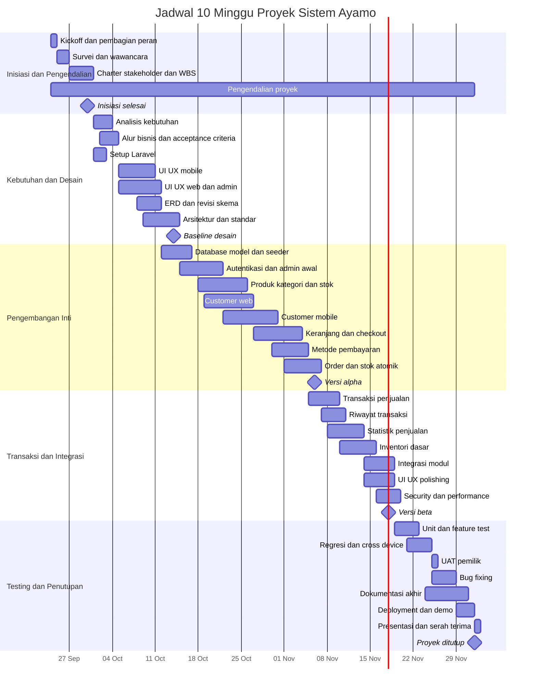

# Rencana Pengelolaan Proyek Sistem Ayamo

Dokumen ini menjadi baseline jadwal, tanggung jawab, estimasi usaha, biaya, dan risiko proyek Sistem Ayamo selama 10 minggu. Rencana mempertahankan pekerjaan yang telah dilakukan sejak akhir September 2026 dan memberi waktu yang wajar untuk implementasi, integrasi, pengujian, UAT, dokumentasi, serta rilis.

## 1. Dasar Perencanaan

| Parameter | Nilai |
|---|---|
| Nama proyek | Pembangunan Sistem Informasi dan Statistik Penjualan UMKM Ayamo |
| Periode baseline | 24 September 2026 sampai 2 Desember 2026 |
| Durasi | 10 minggu kalender |
| Metode | Iteratif; satu sprint berdurasi satu minggu |
| Satuan usaha | 1 manday = 8 jam kerja efektif |
| Ruang lingkup | Katalog produk, customer web/mobile, keranjang dan pesanan, metode pembayaran manual, panel admin, transaksi, stok, serta statistik penjualan |
| Di luar ruang lingkup | Payment gateway otomatis, pelacakan kurir GPS, aplikasi mobile native, dan akuntansi penuh |
| Baseline biaya | Nilai tenaga kerja adalah biaya ekuivalen internal untuk estimasi proyek akademik, bukan kewajiban pembayaran aktual |

## 2. Project Schedule

### 2.1 Kalender 10 Minggu

| Minggu | Periode | Fokus | Deliverable Utama |
|---:|---|---|---|
| 1 | 24-30 September 2026 | Inisiasi, survei, peran, dan WBS | Project Charter, Stakeholder Register, WBS, workspace |
| 2 | 1-7 Oktober 2026 | Kebutuhan dan setup proyek | Baseline kebutuhan dan Laravel starter |
| 3 | 8-14 Oktober 2026 | UI/UX, ERD, dan arsitektur | Mockup, ERD, arsitektur, standar teknis |
| 4 | 15-21 Oktober 2026 | Fondasi backend dan admin | Database, autentikasi, dashboard admin awal |
| 5 | 22-28 Oktober 2026 | Produk dan customer panel | CRUD produk, katalog web, mobile responsive |
| 6 | 29 Oktober-4 November 2026 | Keranjang, checkout, dan order | Alur pemesanan dan metode pembayaran manual |
| 7 | 5-11 November 2026 | Transaksi, statistik, dan stok | Riwayat transaksi, analitik, stok dasar |
| 8 | 12-18 November 2026 | Integrasi dan hardening | Versi beta terintegrasi |
| 9 | 19-25 November 2026 | Testing dan UAT | Hasil regresi, UAT, dan daftar perbaikan |
| 10 | 26 November-2 Desember 2026 | Perbaikan, dokumentasi, dan rilis | Release candidate, laporan, demo, serah terima |

### 2.2 Daftar Aktivitas dan Dependensi

| ID WBS | Minggu | Aktivitas | Durasi | Mulai | Selesai | Dependensi | PIC Utama | Output |
|---|---:|---|---:|---|---|---|---|---|
| 1.1 | 1 | Kickoff, pembagian peran, dan aturan kerja | 1 hari | 2026-09-24 | 2026-09-24 | - | Ruhmita | Struktur tim dan aturan kerja |
| 1.2 | 1 | Survei, wawancara, dan dokumentasi UMKM | 2 hari | 2026-09-25 | 2026-09-26 | 1.1 | Ruhmita | Catatan kebutuhan bisnis |
| 1.3 | 1 | Project Charter, Stakeholder Register, dan WBS | 4 hari | 2026-09-27 | 2026-09-30 | 1.2 | Ruhmita | Baseline inisiasi proyek |
| 1.4 | 1-10 | Pengendalian jadwal, scope, risiko, dan evaluasi sprint | 10 minggu | 2026-09-24 | 2026-12-02 | 1.1 | Ruhmita | Catatan evaluasi dan pembaruan baseline |
| 2.1 | 2 | Analisis kebutuhan fungsional dan nonfungsional | 3 hari | 2026-10-01 | 2026-10-03 | 1.2 | Ruhmita | Spesifikasi kebutuhan |
| 2.2 | 2 | Pemodelan alur bisnis, use case, dan acceptance criteria | 3 hari | 2026-10-02 | 2026-10-04 | 2.1 | Ruhmita | Alur sistem dan kriteria penerimaan |
| 2.3 | 2 | Workspace, repository, dan inisialisasi Laravel | 2 hari | 2026-10-01 | 2026-10-02 | 1.1 | Muhammad Rifki Aulia Pratama | Starter project dapat dijalankan |
| 2.4 | 2 | Review dan persetujuan baseline ruang lingkup | 1 hari | 2026-10-07 | 2026-10-07 | 2.1, 2.2 | Ruhmita | Baseline scope disetujui |
| 3.1 | 2-3 | Desain UI/UX customer mobile | 6 hari | 2026-10-05 | 2026-10-10 | 2.1 | Fazah Rizki Fatahillah | Mockup mobile |
| 3.2 | 2-3 | Desain UI/UX web dan panel admin | 7 hari | 2026-10-05 | 2026-10-11 | 2.1 | Fazah Rizki Fatahillah | Mockup web dan admin |
| 3.3 | 3 | ERD, struktur database, dan revisi skema | 4 hari | 2026-10-08 | 2026-10-11 | 2.1, 2.2 | Muhammad Rifki Aulia Pratama | ERD final awal |
| 3.4 | 3 | Arsitektur, keamanan, dan standar pengembangan | 6 hari | 2026-10-09 | 2026-10-14 | 2.3, 3.3 | Muhammad Rifki Aulia Pratama | Dokumen arsitektur dan konvensi |
| 4.1 | 3-4 | Migration, model, seeder, dan koneksi database | 5 hari | 2026-10-12 | 2026-10-16 | 3.3, 3.4 | Muhammad Rifki Aulia Pratama | Database dapat dimigrasikan |
| 4.2 | 4 | Autentikasi, session, dan dashboard admin awal | 7 hari | 2026-10-15 | 2026-10-21 | 4.1 | Muhammad Rifki Aulia Pratama | Admin panel awal |
| 4.3 | 4-5 | Manajemen produk, kategori, dan stok produk | 8 hari | 2026-10-18 | 2026-10-25 | 4.1, 4.2 | Muhammad Rifki Aulia Pratama | CRUD produk dan kategori |
| 4.4 | 4-5 | Katalog, detail produk, dan customer web | 8 hari | 2026-10-19 | 2026-10-26 | 3.2, 4.1 | Fazah dan Rafi | Customer panel web |
| 5.1 | 5-6 | Customer mobile dan responsivitas | 9 hari | 2026-10-22 | 2026-10-30 | 3.1, 4.4 | Fazah dan Rafi | Customer panel mobile |
| 5.2 | 5-6 | Keranjang, kalkulasi total, dan checkout | 8 hari | 2026-10-27 | 2026-11-03 | 4.4, 5.1 | Rafi Alamsyah | Alur keranjang dan checkout |
| 5.3 | 6 | Metode pembayaran tunai, transfer, dan QRIS manual | 6 hari | 2026-10-30 | 2026-11-04 | 5.2 | Muhammad Rifki Aulia Pratama | Pilihan pembayaran dan validasi |
| 5.4 | 6-7 | Konfirmasi order dan pembaruan stok atomik | 6 hari | 2026-11-01 | 2026-11-06 | 4.3, 5.2 | Muhammad Rifki Aulia Pratama | Pemrosesan order dan stok |
| 6.1 | 7 | Pencatatan transaksi dan penjualan manual | 5 hari | 2026-11-05 | 2026-11-09 | 5.4 | Muhammad Rifki Aulia Pratama | Data transaksi terstruktur |
| 6.2 | 7 | Riwayat dan detail transaksi | 4 hari | 2026-11-07 | 2026-11-10 | 6.1 | Rafi Alamsyah | Riwayat transaksi |
| 6.3 | 7-8 | Statistik omzet, transaksi, dan produk terlaris | 6 hari | 2026-11-08 | 2026-11-13 | 6.1 | Muhammad Rifki Aulia Pratama | Dashboard analitik |
| 6.4 | 7-8 | Inventori dasar dan peringatan stok | 6 hari | 2026-11-10 | 2026-11-15 | 4.3, 6.1 | Muhammad Rifki Aulia Pratama | Monitoring stok dasar |
| 7.1 | 8 | Integrasi customer, admin, order, transaksi, dan laporan | 5 hari | 2026-11-14 | 2026-11-18 | 5.4, 6.2, 6.3, 6.4 | Muhammad Rifki Aulia Pratama | Versi beta terintegrasi |
| 7.2 | 8 | UI/UX polishing dan aksesibilitas dasar | 5 hari | 2026-11-14 | 2026-11-18 | 5.1, 6.2, 6.3 | Fazah dan Rafi | UI konsisten dan responsif |
| 7.3 | 8-9 | Hardening keamanan dan optimasi performa | 4 hari | 2026-11-16 | 2026-11-19 | 7.1 | Muhammad Rifki Aulia Pratama | Build kandidat pengujian |
| 8.1 | 9 | Penyusunan dan pelaksanaan unit/feature test | 4 hari | 2026-11-19 | 2026-11-22 | 7.1 | Rafi Alamsyah | Hasil pengujian modul |
| 8.2 | 9 | Integration, regression, dan cross-device testing | 4 hari | 2026-11-21 | 2026-11-24 | 7.2, 7.3, 8.1 | Rafi Alamsyah | Defect log dan hasil regresi |
| 8.3 | 9 | UAT bersama pemilik UMKM | 1 hari | 2026-11-25 | 2026-11-25 | 8.2 | Ruhmita | Berita acara dan masukan UAT |
| 8.4 | 9-10 | Perbaikan defect dan penyesuaian UAT | 4 hari | 2026-11-25 | 2026-11-28 | 8.3 | Muhammad Rifki Aulia Pratama | Release candidate |
| 9.1 | 9-10 | Laporan akhir, user guide, dan dokumentasi teknis | 7 hari | 2026-11-24 | 2026-11-30 | 8.1 | Seluruh tim | Dokumen akhir proyek |
| 9.2 | 10 | Deployment, seed demo, dan persiapan presentasi | 3 hari | 2026-11-29 | 2026-12-01 | 8.4, 9.1 | Muhammad Rifki Aulia Pratama | Sistem demo siap |
| 9.3 | 10 | Presentasi, demonstrasi, dan serah terima | 1 hari | 2026-12-02 | 2026-12-02 | 9.2 | Ruhmita | Proyek ditutup |

### 2.3 Milestone

| ID | Milestone | Tanggal | Kriteria Selesai |
|---|---|---|---|
| MS-01 | Inisiasi selesai | 2026-09-30 | Charter, stakeholder, WBS, peran, dan workspace tersedia |
| MS-02 | Kebutuhan dibekukan | 2026-10-07 | Scope dan acceptance criteria disetujui |
| MS-03 | Baseline desain selesai | 2026-10-14 | UI/UX, ERD, dan arsitektur siap menjadi acuan |
| MS-04 | Versi alpha selesai | 2026-11-06 | Produk, customer panel, order, pembayaran, dan stok inti berjalan |
| MS-05 | Versi beta terintegrasi | 2026-11-18 | Seluruh modul inti terhubung dan siap diuji |
| MS-06 | UAT selesai | 2026-11-25 | Masukan pemilik UMKM tercatat |
| MS-07 | Rilis dan penutupan | 2026-12-02 | Defect kritis ditutup, dokumentasi dan demo selesai |

### 2.4 Gantt Chart

## 3. Resource and Responsibility Plan

### 3.1 Anggota Tim

| Anggota | Peran | Tanggung Jawab | Deliverable Utama | Alokasi |
|---|---|---|---|---:|
| Ruhmita | Project Manager dan Business Analyst | Scope, jadwal, kebutuhan, koordinasi stakeholder, UAT, serta dokumentasi manajemen dan requirement | Baseline proyek, requirement, keputusan scope, hasil UAT | 15.50 manday |
| Fazah Rizki Fatahillah | Frontend dan UI/UX Specialist | Mockup, design system, frontend utama, responsivitas, polishing, serta dokumentasi desain dan frontend | UI/UX dan frontend customer/admin | 29.00 manday |
| Muhammad Rifki Aulia Pratama | Backend Lead dan DevOps | Arsitektur, database, backend, keamanan, integrasi, deployment, serta dokumentasi backend | Database, admin, order, transaksi, analitik, build demo | 51.00 manday |
| Rafi Alamsyah | Frontend Developer dan QA Tester | Implementasi frontend bersama Fazah, test case, pengujian integrasi/regresi, defect tracking, dan dokumentasi pengujian | Frontend customer, hasil test, defect log, validasi rilis | 39.00 manday |
| Rafi Alamsyah sebagai pemilik UMKM | Product Owner dan narasumber | Validasi kebutuhan, data bisnis, prioritas, dan UAT | Persetujuan kebutuhan dan penerimaan hasil | Sesuai kebutuhan validasi |
| Ibu Cut Alna Fadila | Dosen dan supervisor | Arahan akademik dan evaluasi keluaran | Umpan balik dan penilaian | Sesuai jadwal evaluasi |

### 3.2 Pembagian Manday Lintas Peran

| Anggota | PM/BA | Frontend/UIUX | Backend/DevOps | QA/Testing | Total |
|---|---:|---:|---:|---:|---:|
| Ruhmita | 14.50 | 0.00 | 0.00 | 1.00 | 15.50 |
| Fazah Rizki Fatahillah | 0.00 | 29.00 | 0.00 | 0.00 | 29.00 |
| Muhammad Rifki Aulia Pratama | 0.00 | 0.00 | 50.50 | 0.50 | 51.00 |
| Rafi Alamsyah | 0.00 | 11.75 | 0.00 | 27.25 | 39.00 |
| **Total** | **14.50** | **40.75** | **50.50** | **28.75** | **134.50** |

Manday dokumentasi melekat pada aktivitas masing-masing dan tidak dibuat sebagai peran terpisah. Dengan demikian, setiap anggota wajib memperbarui dokumentasi sebagai bagian dari Definition of Done pekerjaannya.

### 3.3 Matriks RACI

Keterangan: **R** = Responsible, **A** = Accountable, **C** = Consulted, dan **I** = Informed.

| Kelompok Pekerjaan | Ruhmita | Fazah | Muhammad Rifki | Rafi Alamsyah |
|---|:---:|:---:|:---:|:---:|
| Inisiasi, kebutuhan, scope, dan jadwal | A/R | C | C | R |
| UI/UX dan frontend | C | A/R | C | R |
| Arsitektur, database, dan backend | C | C | A/R | I |
| Integrasi, keamanan, dan deployment | I | C | A/R | R |
| Testing dan defect management | C | C | R | A/R |
| UAT dan penerimaan | A/R | C | R | R |
| Dokumentasi dan laporan | A/R | R | R | R |

Dokumentasi teknis merupakan tanggung jawab bersama. Setiap anggota memperbarui dokumentasi pada area yang dikerjakan; Ruhmita menjaga konsistensi dokumen manajemen, Fazah dan Rafi mendokumentasikan frontend serta pengujian, dan Muhammad Rifki mendokumentasikan arsitektur, database, backend, keamanan, serta deployment.

### 3.4 Kebutuhan Sumber Daya

| Kategori | Sumber Daya | Jumlah | Kegunaan | Status |
|---|---|---:|---|---|
| Hardware | Laptop pengembangan | 4 unit | Pengembangan, desain, pengujian, dokumentasi | Milik tim |
| Hardware | Smartphone Android | Minimal 2 unit | Pengujian mobile dan variasi layar | Milik tim |
| Hardware | Laptop/desktop UMKM | 1 unit | UAT admin dan customer web | Milik mitra |
| Software | Laravel, PHP, Composer, Node.js, MySQL/MariaDB | 1 environment per developer | Pengembangan aplikasi | Open source |
| Desain | Figma | 1 workspace | Mockup dan prototipe | Paket gratis |
| Kolaborasi | GitHub, Git, dan Lark Base | 1 repository dan 1 base | Version control dan project control | Paket gratis |
| Pengujian | Browser modern dan developer tools | Minimal 3 browser | Kompatibilitas dan responsivitas | Gratis |
| Infrastruktur | Hosting demo dan domain | 1 paket | Demo publik dan UAT | Dianggarkan |
| Operasional | Internet, transportasi, dan materi presentasi | Sesuai kebutuhan | Koordinasi dan penyerahan | Dianggarkan |

## 4. Effort Estimation

### 4.1 Estimasi Manday per Aktivitas

| ID | Aktivitas | PM/BA | Frontend/UIUX | Backend/DevOps | QA/Testing | Total |
|---|---|---:|---:|---:|---:|---:|
| 1.1 | Kickoff dan pembagian peran | 0.50 | 0.25 | 0.50 | 0.25 | 1.50 |
| 1.2 | Survei dan wawancara | 1.00 | 0.50 | 0.50 | 0.50 | 2.50 |
| 1.3 | Charter, stakeholder, dan WBS | 1.50 | 0.50 | 0.50 | 1.00 | 3.50 |
| 1.4 | Pengendalian proyek | 2.00 | 1.00 | 1.00 | 1.00 | 5.00 |
| 2.1 | Analisis kebutuhan | 1.50 | 1.00 | 0.50 | 1.00 | 4.00 |
| 2.2 | Alur bisnis dan acceptance criteria | 1.00 | 1.00 | 0.50 | 0.50 | 3.00 |
| 2.3 | Workspace dan Laravel setup | 0.50 | 0.00 | 2.00 | 0.00 | 2.50 |
| 2.4 | Persetujuan baseline scope | 0.50 | 0.50 | 0.50 | 0.50 | 2.00 |
| 3.1 | UI/UX customer mobile | 0.50 | 3.00 | 0.00 | 0.50 | 4.00 |
| 3.2 | UI/UX web dan admin | 0.50 | 3.00 | 0.50 | 0.50 | 4.50 |
| 3.3 | ERD dan revisi skema | 0.50 | 0.00 | 2.50 | 0.50 | 3.50 |
| 3.4 | Arsitektur dan standar | 0.50 | 0.50 | 2.00 | 1.00 | 4.00 |
| 4.1 | Migration, model, dan seeder | 0.00 | 0.00 | 3.00 | 0.50 | 3.50 |
| 4.2 | Autentikasi dan admin awal | 0.00 | 2.00 | 2.50 | 0.50 | 5.00 |
| 4.3 | Produk, kategori, dan stok | 0.00 | 2.00 | 2.50 | 0.50 | 5.00 |
| 4.4 | Customer web | 0.00 | 3.50 | 2.00 | 0.50 | 6.00 |
| 5.1 | Customer mobile | 0.00 | 3.00 | 1.50 | 0.50 | 5.00 |
| 5.2 | Keranjang dan checkout | 0.00 | 3.00 | 2.00 | 0.50 | 5.50 |
| 5.3 | Metode pembayaran | 0.00 | 1.50 | 2.00 | 0.50 | 4.00 |
| 5.4 | Order dan stok atomik | 0.00 | 1.50 | 2.50 | 0.50 | 4.50 |
| 6.1 | Transaksi penjualan | 0.00 | 1.00 | 2.50 | 0.50 | 4.00 |
| 6.2 | Riwayat transaksi | 0.00 | 1.00 | 1.50 | 0.50 | 3.00 |
| 6.3 | Statistik penjualan | 0.50 | 1.50 | 2.50 | 1.00 | 5.50 |
| 6.4 | Inventori dasar | 0.50 | 1.00 | 2.00 | 0.50 | 4.00 |
| 7.1 | Integrasi modul | 0.00 | 1.00 | 2.00 | 1.50 | 4.50 |
| 7.2 | UI/UX polishing | 0.00 | 2.00 | 0.50 | 1.50 | 4.00 |
| 7.3 | Security dan performance | 0.00 | 0.50 | 2.00 | 1.50 | 4.00 |
| 8.1 | Unit dan feature test | 0.00 | 0.50 | 1.50 | 2.50 | 4.50 |
| 8.2 | Regresi dan cross-device | 0.00 | 1.00 | 1.50 | 2.50 | 5.00 |
| 8.3 | UAT | 1.00 | 0.50 | 1.00 | 1.00 | 3.50 |
| 8.4 | Bug fixing dan revisi UAT | 0.00 | 1.50 | 2.00 | 1.00 | 4.50 |
| 9.1 | Dokumentasi akhir | 1.00 | 0.50 | 0.50 | 2.00 | 4.00 |
| 9.2 | Deployment dan demo | 0.50 | 0.50 | 1.50 | 1.00 | 3.50 |
| 9.3 | Presentasi dan serah terima | 0.50 | 0.50 | 0.50 | 0.50 | 2.00 |
| **Total** |  | **14.50** | **40.75** | **50.50** | **28.75** | **134.50** |

### 4.2 Ringkasan Effort per Kelompok WBS

| Kelompok | Manday | Persentase |
|---|---:|---:|
| 1. Manajemen dan inisiasi | 12.50 | 9.29% |
| 2. Analisis kebutuhan dan setup | 11.50 | 8.55% |
| 3. Perancangan sistem | 16.00 | 11.90% |
| 4. Fondasi aplikasi dan katalog | 19.50 | 14.50% |
| 5. Customer flow dan order | 19.00 | 14.13% |
| 6. Transaksi, statistik, dan stok | 16.50 | 12.27% |
| 7. Integrasi dan hardening | 12.50 | 9.29% |
| 8. Testing dan UAT | 17.50 | 13.01% |
| 9. Dokumentasi dan rilis | 9.50 | 7.06% |
| **Total** | **134.50** | **100.00%** |

## 5. Project Cost Estimation

### 5.1 Biaya Tenaga Kerja

| Peran | Manday | Tarif per Manday | Estimasi |
|---|---:|---:|---:|
| Project Manager dan Business Analyst | 14.50 | Rp200.000 | Rp2.900.000 |
| Frontend dan UI/UX (Fazah dan Rafi) | 40.75 | Rp180.000 | Rp7.335.000 |
| Backend Lead dan DevOps | 50.50 | Rp220.000 | Rp11.110.000 |
| QA dan Testing | 28.75 | Rp160.000 | Rp4.600.000 |
| **Total tenaga kerja** | **134.50** |  | **Rp25.945.000** |

### 5.2 Biaya Layanan dan Operasional

| Item | Perhitungan | Estimasi |
|---|---|---:|
| Software open source, GitHub, Lark Base, dan Figma free tier | Paket gratis | Rp0 |
| Laptop dan smartphone pengujian | Perangkat milik tim | Rp0 |
| Hosting demo | 3 bulan x Rp150.000 | Rp450.000 |
| Domain | 1 tahun | Rp175.000 |
| Internet | 4 anggota x Rp250.000 | Rp1.000.000 |
| Transportasi survei, review, dan UAT | 3 kegiatan x Rp100.000 | Rp300.000 |
| Cetak dan materi presentasi | 1 paket | Rp200.000 |
| **Total layanan dan operasional** |  | **Rp2.125.000** |

### 5.3 Rekapitulasi

| Komponen | Nilai |
|---|---:|
| Tenaga kerja | Rp25.945.000 |
| Layanan dan operasional | Rp2.125.000 |
| Subtotal biaya langsung | Rp28.070.000 |
| Overhead manajemen, 5% biaya tenaga kerja | Rp1.297.250 |
| Cadangan risiko, 10% subtotal biaya langsung | Rp2.807.000 |
| **Total estimasi proyek** | **Rp32.174.250** |

Jika tenaga kerja merupakan kontribusi akademik tanpa honor dan demo dilakukan secara lokal, kebutuhan kas minimum diperkirakan **Rp1.500.000**, yaitu untuk internet, transportasi, dan materi presentasi.

## 6. Risk Register

Skala probabilitas dan dampak menggunakan nilai 1-5. Skor adalah **Probabilitas x Dampak**. Kategori: 1-4 rendah, 5-9 sedang, 10-15 tinggi, dan 16-25 sangat tinggi.

| ID | Risiko | P | I | Skor | Level | Strategi dan Mitigasi | Pemilik | Indikator |
|---|---|---:|---:|---:|---|---|---|---|
| R-01 | Jadwal sprint terlambat | 4 | 4 | 16 | Sangat tinggi | Batasi WIP, review dua kali seminggu, lindungi critical path, pindahkan fitur noninti ke backlog | Ruhmita | Critical path terlambat lebih dari 2 hari |
| R-02 | Scope creep dari POS, inventori, role, atau pembayaran | 4 | 4 | 16 | Sangat tinggi | Terapkan baseline dan change request dengan dampak waktu/biaya sebelum pekerjaan dimulai | Ruhmita | Card baru masuk sprint tanpa estimasi |
| R-03 | Kebutuhan bisnis berubah | 3 | 4 | 12 | Tinggi | Prototype dini, decision log, acceptance criteria, dan konfirmasi pemilik | Ruhmita | Revisi besar setelah modul selesai |
| R-04 | Data uji tidak representatif | 3 | 3 | 9 | Sedang | Dataset realistis dan validasi sampel dengan pemilik | Rafi Alamsyah | Statistik tidak dapat diverifikasi |
| R-05 | Konflik kode dan integrasi gagal | 3 | 4 | 12 | Tinggi | Branch per fitur, pull request kecil, sinkronisasi rutin, dan review sebelum merge | Muhammad Rifki Aulia Pratama | Build utama gagal atau konflik berulang |
| R-06 | Stok negatif atau transaksi ganda | 3 | 5 | 15 | Tinggi | Database transaction, locking, validasi server-side, dan test konkurensi | Muhammad Rifki Aulia Pratama | Stok negatif atau duplikasi transaksi |
| R-07 | Akses admin tidak aman | 3 | 5 | 15 | Tinggi | Hash password, middleware, throttle, CSRF, session review, dan audit otorisasi | Muhammad Rifki Aulia Pratama | Akses admin tanpa session valid |
| R-08 | UI tidak responsif | 3 | 3 | 9 | Sedang | Uji minimal dua smartphone dan tiga browser dengan mobile-first breakpoint | Fazah dan Rafi | Elemen terpotong atau checkout gagal |
| R-09 | Statistik penjualan tidak akurat | 3 | 5 | 15 | Tinggi | Definisikan rumus, gunakan expected result manual, dan validasi pemilik | Rafi Alamsyah | Dashboard berbeda dari hitung manual |
| R-10 | Kehilangan data atau perubahan lokal | 2 | 5 | 10 | Tinggi | Push harian, backup sebelum UAT, migration terkontrol, dan larangan secret di repository | Muhammad Rifki Aulia Pratama | Perubahan hanya tersedia pada satu laptop |
| R-11 | UAT tertunda | 3 | 4 | 12 | Tinggi | Jadwalkan H-7, sediakan opsi daring dan video demo, serta tunjuk perwakilan | Ruhmita | Jadwal belum dikonfirmasi H-3 |
| R-12 | Hosting atau demo gagal | 2 | 4 | 8 | Sedang | Demo lokal, seed data, rekaman cadangan, dan checklist deployment | Muhammad Rifki Aulia Pratama | Health check gagal |
| R-13 | Biaya melampaui baseline | 2 | 3 | 6 | Sedang | Review biaya mingguan dan gunakan cadangan hanya dengan persetujuan PM | Ruhmita | Cadangan terpakai lebih dari 50% sebelum UAT |
| R-14 | Dokumentasi tidak sesuai aplikasi | 3 | 3 | 9 | Sedang | Dokumentasi menjadi bagian Definition of Done dan diaudit lintas peran sebelum rilis | Seluruh tim | Nama fitur atau skema berbeda dari aplikasi |
| R-15 | Beban anggota tim tidak seimbang | 3 | 4 | 12 | Tinggi | Pantau alokasi manday, lakukan pair work, dan redistribusi aktivitas nonspesialis | Ruhmita | Satu anggota memiliki blocker lebih dari 3 hari |

## 7. Mekanisme Pengendalian

| Area | Mekanisme | Frekuensi | Bukti |
|---|---|---|---|
| Jadwal | Review Lark Base, blocker, dan critical path | Dua kali per minggu | Record aktivitas, due date, dan evaluasi sprint |
| Scope | Change request untuk item di luar baseline | Setiap usulan perubahan | Keputusan dan analisis dampak |
| Effort | Jam aktual dibagi 8 jam per manday | Mingguan | Timesheet atau activity log |
| Biaya | Bandingkan aktual, baseline, dan cadangan | Mingguan | Cost log |
| Kualitas | Test case, defect log, regresi, dan UAT | Setiap kandidat build | Hasil test dan bukti UAT |
| Risiko | Tinjau skor, indikator, dan mitigasi | Akhir setiap sprint | Risk register terbaru |

## 8. Struktur Lark Base

Pisahkan data menjadi lima table view: **Schedule**, **Resources**, **Effort**, **Cost**, dan **Risks**. Gunakan Date untuk tanggal, Number untuk durasi/manday/skor, Currency untuk biaya, Single Select untuk minggu/level/strategi, dan Person untuk PIC. Hubungkan `ID WBS` pada Schedule dan Effort menggunakan Relation field. Basis kerja proyek tersedia di [Lark Base Proyek Ayamo](https://zjpwcuecoylf.jp.larksuite.com/base/Zl4qbsdyeaYoJwsvF6zjJ24Cp5b?from=from_copylink).
