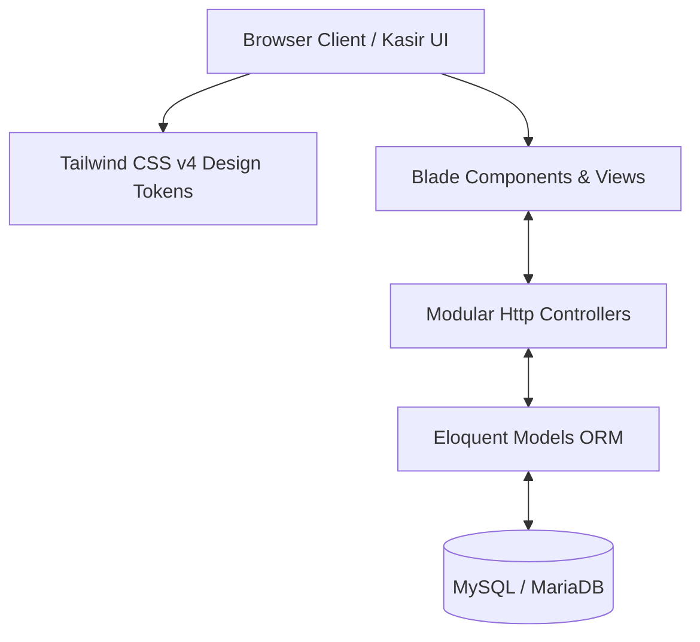

# 🏗️ Arsitektur Sistem Ayamo

Dokumen ini menjelaskan fondasi arsitektur, tumpukan teknologi (tech stack), serta alur kerja teknis aplikasi web **Ayamo**.

---

## 1. Tumpukan Teknologi (Tech Stack)

Sistem Ayamo memanfaatkan arsitektur modern berbasis Laravel 12 dan Tailwind CSS:



### Rincian Komponen:
1. **Laravel 12 (Core Backend)**
   - Mengatur alur bisnis, routing modular, validasi request, sesi admin, dan interaksi basis data Eloquent ORM.
   - Menggunakan PHP 8.4+ dengan fitur tipe data ketat (*strict types* & *constructor property promotion*).
2. **Modular Controllers**
   - Pemisahan tanggung jawab controller per domain fungsional:
     - `Customer\Mobile*Controller`: katalog, keranjang, checkout, pembayaran, status, dan riwayat untuk tampilan mobile.
     - `Customer\Web*Controller`: controller modular untuk alur customer web dengan aturan bisnis bersama dari storefront.
     - `Admin\AuthController`: Otentikasi login/logout admin & proteksi brute-force (`LoginAttempt`).
     - `Admin\DashboardController`: Ringkasan metrik omzet, laporan UMKM filter tanggal/sumber + export CSV, pengelolaan pengaturan terstruktur (`updateSettings`), serta CRUD pengaturan key-value fleksibel (`upsertSettingKey`, `destroySettingKey`).
     - `Admin\OrderController`: Transisi status 4 tahap (`pending` -> `processing` -> `ready` -> `confirmed` / `cancelled`) dengan reservasi & pemulihan stok atomik serta sinkronisasi `Transaction`.
     - `Admin\ProductController`: CRUD katalog produk, upload/URL foto (`public/img/uploads`), penyesuaian stok cepat (`adjustStock`), pengarsipan, dan pemulihan produk.
     - `Admin\TransactionController`: Pencatatan transaksi kasir POS manual multi-item langsung di dashboard (`manualSale`).
   - Middleware keamanan dan sesi:
     - `AdminSession` (`admin.session`): proteksi rute admin dan header `Cache-Control: no-store, no-cache, ...`.
     - `SecurityHeaders`: menyematkan header `X-Content-Type-Options: nosniff`, `X-Frame-Options: SAMEORIGIN`, `Referrer-Policy`, dan `Permissions-Policy`.
3. **Eloquent ORM Models**
   - `Product`: Master produk (8 varian default), harga, stok, `getImageUrlAttribute()` (fallback aset `/img/cat-paha.png` -> `/img/cat-dada.png`), dan `seedDefaults()`.
   - `Order`: Pesanan pelanggan online dengan payload item JSON, penanda `stock_reserved`, dan generator kode bebas bentrok `Order::generateCode()` (`AYM-YYMMDD-XXXX`).
   - `Transaction`: Rekap mutasi transaksi penjualan online terkonfirmasi (`order-<id>`) dan kasir manual POS.
   - `Settings`: Pengaturan toko key-value fleksibel, `protectedKeys()`, normalisasi multi-channel pembayaran (`getPaymentChannels()`), dan evaluator jam operasional + override buka/tutup toko (`getStoreStatus()` dengan zona waktu `Asia/Jakarta`).
   - `LoginAttempt`: Pelacakan percobaan login gagal & lockout throttle.
   - `User`: Model pengguna aplikasi.
4. **Tailwind CSS v4 & Theme Design System**
   - Mesin styling modern menggunakan variabel CSS dan `@theme` dengan token warna kuliner warm appetizing (*Gold, Orange, Sand, Green, Red, Sky*), dark mode switcher, serta badge level kepedasan (*Spice Level*).
5. **MySQL / MariaDB**
   - Basis data relasional penyimpan data pengguna, katalog menu, pesanan, detail transaksi kasir, dan riwayat stok.

---

## 2. Struktur Modul & Infrastruktur (`Kelompok-17/`)

```text
Kelompok-17/
├── Dockerfile                                  # Multi-stage build produksi (Composer + Node Vite + PHP 8.4-FPM + Nginx)
├── docker-compose.yml                          # Layanan app, mysql:8.4 (healthcheck), dan profil opsional cloudflared
├── .dockerignore                               # Eksklusi vendor, node_modules, .env, & artefak lokal
├── .env.example                                # Template environment Docker Compose produksi
├── docker/
│   ├── Dockerfile                              # Salinan konfigurasi container build
│   ├── entrypoint.sh                           # Auto APP_KEY fallback, wait-for-MySQL, storage:link, migrate, optimize
│   ├── nginx/default.conf                      # Nginx port 8000, gzip, security headers, caching /build & /img
│   └── php/php-prod.ini                        # Tuning OPcache & batas upload PHP produksi
└── app/
    ├── app/
    │   ├── Http/
    │   │   ├── Controllers/
    │   │   │   ├── Admin/
    │   │   │   │   ├── AuthController.php          # Login, logout, lockout throttle
    │   │   │   │   ├── DashboardController.php     # Ringkasan, laporan UMKM + CSV, pengaturan fleksibel
    │   │   │   │   ├── OrderController.php         # Alur status 4-tahap & pemulihan stok
    │   │   │   │   ├── ProductController.php       # CRUD produk, upload gambar & quick stock
    │   │   │   │   └── TransactionController.php   # Kasir POS manual multi-item
    │   │   │   ├── Customer/
    │   │   │   │   ├── MobileStorefrontController.php
    │   │   │   │   ├── Mobile*Controller.php       # Alur customer mobile
    │   │   │   │   └── Web*Controller.php          # Alur customer web
    │   │   │   └── Controller.php
    │   │   └── Middleware/
    │   │       ├── AdminSession.php                # Proteksi session admin & Cache-Control no-store
    │   │       └── SecurityHeaders.php             # Header HTTP defensif
    │   └── Models/
    │       ├── LoginAttempt.php
    │       ├── Order.php
    │       ├── Product.php
    │       ├── Settings.php
    │       ├── Transaction.php
    │       └── User.php
    ├── database/
    │   ├── migrations/                             # Skema tabel, stock_reserved, & widen settings.value ke TEXT
    │   └── seeders/
    │       ├── DatabaseSeeder.php                  # Entry point seeder -> UmkmTestingSeeder
    │       └── UmkmTestingSeeder.php               # Seeder data uji lengkap UMKM (tanpa tabel products)
    ├── resources/
    │   ├── css/
    │   │   └── app.css                             # Tailwind CSS v4 tokens & @layer components
    │   └── views/
    │       ├── admin/                              # Panel admin + partials (overview, orders, products, reports, settings)
    │       ├── components/                         # <x-input-error>, <x-modal-confirmation>, <x-modal-notification>
    │       ├── layouts/                            # web.blade.php, mobile.blade.php
    │       └── customer/                           # View customer web & mobile
    └── routes/
        └── web.php                                 # Routing web, mobile, & admin
```

---

## 3. Pola Interaksi Data & State Management

### A. Alur Pemesanan Online (Customer Journey)
1. **Etalase Menu**: Pelanggan memilih menu melalui `WebCatalogController` atau `MobileCatalogController`.
2. **Keranjang Lokal**: Penambahan item disimpan pada `localStorage` (`ayamo_cart_v1`) sehingga klik **Tambah** tidak mengirim request. Keranjang disinkronkan ke session server saat halaman keranjang dibuka; endpoint server tetap tersedia sebagai fallback ketika JavaScript tidak aktif.
3. **Checkout Transaksi**: `WebCheckoutController` meneruskan proses ke mekanisme bersama `MobileCheckoutController`. Server memvalidasi `checkout_token`, mengunci request duplikat, dan memproses pesanan dalam `DB::transaction()`.
4. **Reservasi Stok**: Semua produk dikunci menggunakan `lockForUpdate()` dalam urutan ID yang konsisten. Stok diperiksa ulang dan dikurangi sebelum order dibuat dengan `stock_reserved = true`.

### B. Alur Manajemen Admin
1. **Otentikasi & Keamanan**: Admin login diverifikasi terhadap hash password dengan batasan percobaan gagal (maks. 5 kali sebelum lockout 15 menit).
2. **Konfirmasi Pesanan**: `Admin\OrderController@confirm` mengunci record order dan mencatat `Transaction`. Stok hanya dikurangi untuk pesanan lama dengan `stock_reserved = false`; pesanan baru tidak dikurangi dua kali.
3. **Penjualan Kasir Manual**: `Admin\TransactionController@manualSale` mencatat penjualan langsung dan memotong stok seketika dalam satu transaksi atomik.

---

## 4. Keamanan & Performa

1. **Proteksi Akses & Header Defensif**: Menggunakan middleware sesi admin (`AdminSession` dengan `Cache-Control: no-store, no-cache, must-revalidate, max-age=0, private`), header HTTP keamanan (`SecurityHeaders`), pembatasan throttle rute storefront (`throttle:60,1`) serta login admin (`throttle:10,1`), dan aksi admin (`throttle:120,1`).
2. **Integritas Konkurensi Stok & Store Override**: Menggunakan *pessimistic locking* (`lockForUpdate()`) di dalam database transaction dengan urutan lock ID produk yang konsisten, flag `orders.stock_reserved`, serta pengecekan `Settings::getStoreStatus()` di endpoint checkout agar toko tutup tidak dapat menerima pesanan baru.
3. **Idempotensi & Kode Pesanan Anti-Collision**: Setiap form checkout memiliki token UUID dengan cache lock untuk mencegah ganda, dan ID/kode pesanan dibuat lewat `Order::generateCode()` (format `AYM-YYMMDD-XXXX` Base32 30^4 per hari, eskalasi otomatis 6 karakter + fallback hash SHA-256).
4. **CSRF, XSS, & CSV Safety**: Seluruh form web dilindungi `@csrf`, output di-escape oleh Blade, dan export CSV menormalkan karakter awal berbahaya (`=`, `+`, `-`, `@`, `\t`, `\r`) untuk mencegah formula injection.

---

## 5. Infrastruktur Kontainer & Deployment (Docker Production)

Seluruh file infrastruktur diletakkan di root repositori agar build context dapat menjangkau `app/` dan folder `docker/` secara bersih:
1. **Multi-Stage `Dockerfile`**:
   - **Stage 1 (`vendor`, `composer:2`)**: menginstal dependensi PHP produksi (`--no-dev --optimize-autoloader`).
   - **Stage 2 (`frontend`, `node:22-bookworm-slim`)**: menyalin `vendor/` dari Stage 1 agar `@import` Flux CSS dan `@source` Tailwind CSS v4 pada `app/resources/css/app.css` terkompilasi utuh melalui `npm run build`.
   - **Stage 3 (`runtime`, `php:8.4-fpm-alpine`)**: menjalankan PHP-FPM 8.4 (OPcache aktif lewat `docker/php/php-prod.ini`) dan Nginx port `8000` (`docker/nginx/default.conf`), dilengkapi `HEALTHCHECK` ke endpoint `/up`.
2. **Orkestrasi `docker-compose.yml`**:
   - Menjalankan service `app`, `mysql` (`mysql:8.4` dengan healthcheck `mysqladmin ping`), dan profil opsional `cloudflared` (`--profile tunnel`).
   - `docker/entrypoint.sh` menangani pembuatan `APP_KEY` fallback bila kosong, menunggu kesiapan MySQL, menautkan storage, menjalankan `php artisan migrate --force` (terkontrol via `AUTORUN_MIGRATIONS`), optional `AUTORUN_SEED`, serta `php artisan optimize`.
