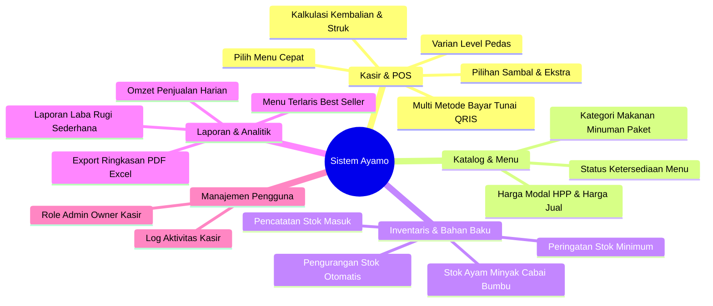

# 📦 Fitur & Modul Sistem Ayamo

Dokumen ini mendeskripsikan cakupan fungsional (*functional requirements*) dan pembagian modul sistem manajemen bisnis untuk UMKM **Ayamo (Ayam Geprek & Fried Chicken)**.

---

## 1. Ikhtisar Modul Utama

---

## 2. Rincian Modul

### A. Modul Customer Ordering (Web & Mobile)

- **Keranjang Lokal Tanpa Request per Klik**: Penambahan produk disimpan di perangkat (`localStorage`) dan baru disinkronkan saat pelanggan membuka keranjang atau melanjutkan ke checkout; server tetap menjadi sumber kebenaran final harga, ketersediaan, dan stok.
- **Status Buka/Tutup Toko Otomatis & Override**: Layout Web, Mobile, dan endpoint checkout mengevaluasi `Settings::getStoreStatus()`. Saat toko sedang ditutup oleh admin (`maintenance_mode = true`) atau di luar jam operasional (`auto`), banner alasan tutup ditampilkan dan pembuatan pesanan baru diblokir.
- **Pembayaran Non-Tunai 2 Tab (Transfer & QRIS)**: Pelanggan yang memilih metode transfer disajikan 2 sub-pilihan: tab **Transfer** (menampilkan semua channel bank/e-wallet aktif beserta tombol salin nomor rekening) dan tab **QRIS** (menampilkan pratinjau QRIS berukuran besar agar jelas dipindai beserta tombol **Unduh Gambar QRIS**).
- **Pencegahan Pesanan Ganda & Kode Anti-Collision**: Checkout memakai `checkout_token` unik dengan cache lock serta generator kode `Order::generateCode()` berformat `AYM-YYMMDD-XXXX`.
- **Reservasi Stok Atomik**: Stok diperiksa serta dialokasikan dalam `DB::transaction()` menggunakan `lockForUpdate()` sebelum order dibuat (`stock_reserved = true`).

### B. Modul Kasir POS & Alur Pesanan Admin

Dirancang untuk kecepatan operasional kasir dan pengelolaan antrean pesanan online:
- **Kasir POS Manual Multi-Item**: Input penjualan langsung di toko dengan pemotongan stok atomik untuk seluruh item dalam satu transaksi.
- **Alur Status Pesanan 4-Tahap**: Visualisasi dan kontrol status yang jelas (`Menunggu Konfirmasi` -> `Diproses` -> `Siap Diambil` -> `Dikonfirmasi / Masuk Kas`, atau `Dibatalkan`). Konfirmasi mencatat `Transaction` `order-<id>` secara idempoten; pembatalan atau pengembalian status membersihkan catatan kas dan mengembalikan stok yang tereservasi.
- **Konfirmasi & Notifikasi Bebas Alert Native**: Seluruh aksi destruktif memakai komponen `<x-modal-confirmation>` (`data-confirm` / `window.AyamoConfirm`) dan umpan balik status memakai `<x-modal-notification>` (antrean toast maks. 5 item, bebas `alert()`/`confirm()` bawaan browser, dan 100% ikon SVG tanpa emoji).

### C. Modul Katalog Produk & Stok Cepat

- **Katalog Produk**: CRUD menu (nama, kategori, deskripsi, harga, stok, foto via upload file ke `public/img/uploads` atau URL/preset dengan pratinjau gambar langsung), arsip (`active = false`), dan pulihkan produk.
- **Quick Stock**: Tombol penyesuaian stok cepat (`+1`, `+5`, `-1`) dan indikator peringatan stok menipis.
- **Fallback Gambar Aman**: `Product::getImageUrlAttribute()` otomatis mengarahkan referensi usang `/img/cat-paha.png` ke `/img/cat-dada.png` agar tidak muncul broken image.

### D. Modul Pengaturan Toko Fleksibel & Channel Pembayaran

- **Override Status Toko**: Pilihan 3 mode status toko (**Buka Paksa**, **Tutup Hari Ini / Override** beserta catatan alasan, dan **Otomatis Sesuai Jam Buka** zona `Asia/Jakarta`).
- **Pengaturan Channel Pembayaran Terstruktur**: Editor UI rapi untuk daftar rekening transfer (tambah/edit/aktifkan channel bank/e-wallet tanpa perlu menulis JSON mentah), upload/URL QRIS, serta pesan WhatsApp.
- **Key-Value Fleksibel**: Panel khusus menambah/mengedit/menghapus key kustom apa saja pada tabel `settings` (`promo_text`, `instagram_handle`, dsb.) sementara key sistem terproteksi akan kembali ke nilai default jika direset.

### E. Modul Laporan Keuangan UMKM & Export CSV

- **Rekap & Filter Penjualan**: Ringkasan eksekutif pendapatan hari ini/periode, pemisahan sumber (**Online** vs **Manual POS**), menu terlaris, dan daftar buku kas.
- **Export CSV Aman**: Unduh laporan CSV dengan perlindungan sanitasi karakter awal (`=`, `+`, `-`, `@`, `\t`, `\r`) terhadap Excel/Spreadsheet formula injection.

### F. Modul Keamanan & Autentikasi Admin

- **Sesi Admin & Proteksi Brute-Force**: Login admin berbasis hash `ADMIN_PASSWORD_HASH` (atau fallback pengaturan) dengan pencatatan gagal login di `login_attempts` (lockout otomatis setelah 5 percobaan gagal), throttle rute, serta header keamanan HTTP.
